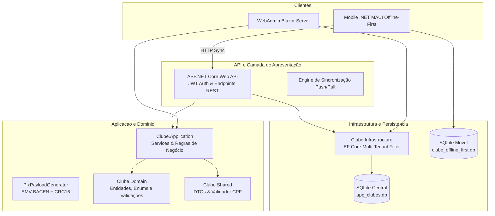

# 🏛️ Projeto Clubes - Sistema Multi-Tenant de Gestão de Clubes & App Móvel Offline-First

[](https://dotnet.microsoft.com/)
[](https://dotnet.microsoft.com/apps/aspnet/web-apps/blazor)
[](https://dotnet.microsoft.com/apps/maui)
[](https://www.sqlite.org/)
[-success)](tests/)

Sistema completo de gestão para Federações e Clubes Sociais (Rotary, Iates, Clubes Campestres e Recreativos), desenvolvido **100% em C# (.NET)** com base nos requisitos detalhados pelo especialista **Carlos Kaneko** no vídeo e transcrição de apoio.

O ecossistema engloba:
1. **ASP.NET Core Web API**: Back-end robusto, isolamento multi-tenant por filtro global do EF Core, autenticação JWT e motor de sincronização bidirecional.
2. **WebAdmin em Blazor Server**: Painel administrativo para **SuperAdmin** (gestão global da federação), **Presidentes** (homologação de cadastros, agenda de reservas e eventos) e **Tesoureiros** (faturamento em lote, cobrança PIX e baixa manual).
3. **Aplicativo Móvel Dedicado (.NET MAUI)**: Experiência nativa para associados e simpatizantes com operação **Offline-First** (banco local SQLite, padrão Outbox e sincronização automática ao restabelecer sinal).
4. **33 Testes Automatizados**: Validação integral de regras de negócios, domínio, concorrência e integrações HTTP.

---

## 🎯 Mapeamento Fiel dos Requisitos (Vídeo Carlos Kaneko & Bloco de Notas)

| Requisito do Vídeo / Bloco de Notas | Onde foi implementado | Descrição da Solução |
| :--- | :--- | :--- |
| **Conjunto de Clubes (Foz 2, Guaíra 2...)** | `Clube.Domain.Entities.Clube`, Multi-Tenant EF Core | Cada clube possui ID, Nome, Sigla, Endereço, Bairro, Cidade, UF, Fone, E-mail, Valor de Mensalidade e Chave PIX. Suporte a federação multi-clube. |
| **Super Admin gerencia todos os clubes** | `Clube.WebAdmin/Components/Pages/SuperAdmin/*` | Visão holística sem filtro de tenant. Criação e edição de novos clubes e credenciamento de diretorias. |
| **Web Presidente libera/admin do clube** | `Clube.WebAdmin/Components/Pages/Presidente/AssociadosAprovacao.razor` | Fila de homologação onde o Presidente aprova ou rejeita filiações com atribuição de categoria. |
| **Tipos de Associado (Fundador c/ voto, Convidado s/ voto, Simpatizante)** | `TipoAssociado`, `Associado.TemDireitoAVoto()` | Regra estrita: apenas o Sócio Fundador Aprovado possui prerrogativa de voto estatutário em assembleias. Convidados e Simpatizantes não votam. |
| **Dependentes com acesso** | `Dependente`, `PerfilViewModel`, `LocalDependente` | Dependentes vinculados ao titular com parentesco, CPF e direito de acesso aos eventos e clube. |
| **Reserva de Espaço (Data/Hora Início a Data/Hora Fim, Feijoada 31/10 a 01/11)** | `ReservaService`, `ReservasAgenda.razor`, `ReservasPage.xaml` | Intervalo contínuo entre datas/horários distintos. Detecção automática de sobreposição e mediação de conflitos pelo Presidente. |
| **Eventos (Dia das Mães, Pais, Café) por público-alvo** | `EventoService`, `EventosGestao.razor`, `EventosPage.xaml` | Configuração de público (`SomenteAssociados` vs `AbertoAoPublico`). Validação no RSVP bloqueando acessos indevidos. |
| **Mensalidade, valor mensal, situação financeira e Tesoureiro Web** | `MensalidadeService`, `MensalidadesPainel.razor`, `MensalidadesPage.xaml` | Painel com KPIs financeiros, faturamento em lote para competências (ex: 11/2026), baixa manual e código PIX. |
| **Código PIX Copia-e-Cola** | `PixPayloadGenerator.cs` | Gerador nativo de payload EMV QRCPS-MPM oficial do BACEN com cálculo algorítmico de checksum CRC16-CCITT. |
| **App Móvel (Cadastrar sócio, Solicitações, Reclamações, Reservas, Mensalidades)** | `Clube.Mobile` (Views e ViewModels XAML/C#) | Módulos dedicados para filiação, ouvidoria/SAC, locação de espaços, conferência de mensalidades e perfil. |
| **Offline-First** | `LocalDatabaseService`, `MobileSyncService`, `SyncController` | Banco SQLite local no dispositivo móvel. Ações salvas em Outbox e sincronizadas transparentemente via `POST /api/sync/push` e `GET /api/sync/pull`. |

---

## 🏛️ Arquitetura da Solução (Clean Architecture 100% .NET)



---

## 🔑 Credenciais Padrão do Sistema (Seed Automático)

Ao iniciar a API ou o WebAdmin pela primeira vez, o banco de dados é provisionado e semeado automaticamente com dados completos:

| Papel / Perfil | Nome | CPF | Senha | Clube | Prerrogativa / Voto |
| :--- | :--- | :--- | :--- | :--- | :--- |
| **Super Admin** | Administrador da Federação | `000.000.000-00` | `Admin@123` | *Global (Todos)* | Gestão global de federação |
| **Presidente** | Carlos Kaneko | `111.111.111-11` | `User@123` | Rotary Foz Ponte | Homologação de sócios e agenda |
| **Tesoureiro** | Marcos Silveira | `222.222.222-22` | `User@123` | Rotary Foz Ponte | Painel financeiro, lote e baixa |
| **Sócio Fundador** | Renato Albuquerque | `333.333.333-33` | `User@123` | Rotary Foz Ponte | **Direito a Voto: SIM** |
| **Sócio Convidado** | Bruno Guimarães | `444.444.444-44` | `User@123` | Rotary Foz Ponte | **Direito a Voto: NÃO** (Avaliativo) |
| **Simpatizante** | Juliana Mendes | `555.555.555-55` | `User@123` | Rotary Foz Ponte | **Direito a Voto: NÃO** (Comunitário) |
| **Presidente Guaíra** | Roberto Justus Guaíra | `666.666.666-66` | `User@123` | Iate Clube Guaíra | Gestão do clube de Guaíra |

> 💡 **Dica no WebAdmin:** No topo do portal Blazor há um seletor rápido para alternar instantaneamente entre os perfis de **SuperAdmin**, **Carlos Kaneko (Presidente)** e **Tesoureiro**, facilitando a demonstração sem necessidade de re-login.

---

## 🚀 Como Executar o Projeto

### Pré-requisitos
- [.NET 10.0 SDK](https://dotnet.microsoft.com/download) ou superior.
- Workload .NET MAUI instalado (`dotnet workload install maui`).

### 1. Executando a ASP.NET Core Web API
```bash
cd src/Clube.Api
dotnet run
```
- Swagger UI disponível em: `http://localhost:5000/swagger` ou `https://localhost:5001/swagger`.

### 2. Executando o Painel Web Administrativo (Blazor Server)
```bash
cd src/Clube.WebAdmin
dotnet run
```
- Acesse pelo navegador: `http://localhost:5100` ou a porta informada no terminal.

### 3. Executando o Aplicativo Móvel (.NET MAUI)

**No Windows Desktop:**
```bash
cd src/Clube.Mobile
dotnet build -f net10.0-windows10.0.19041.0
dotnet run -f net10.0-windows10.0.19041.0
```

**No Android Emulator:**
```bash
cd src/Clube.Mobile
dotnet build -f net10.0-android
```

---

## 🧪 Suíte de Testes Automatizados (33 Testes)

A solução conta com cobertura extensiva em 3 projetos dedicados:
- **`Clube.Domain.Tests`**: 19 testes unitários (Entidades, regras de voto, validação algorítmica de CPF com dígitos verificadores e enums).
- **`Clube.Application.Tests`**: 10 testes (Isolamento multi-tenant, motor de colisão contínua de reservas, algoritmo PIX EMV com CRC16, motor outbox de sincronização e cenários E2E do vídeo de Carlos Kaneko).
- **`Clube.Api.IntegrationTests`**: 4 testes de integração de ponta a ponta com `WebApplicationFactory` e banco de dados SQLite isolado.

Para rodar todos os testes:
```bash
dotnet test tests/Clube.Domain.Tests/Clube.Domain.Tests.csproj
dotnet test tests/Clube.Application.Tests/Clube.Application.Tests.csproj
dotnet test tests/Clube.Api.IntegrationTests/Clube.Api.IntegrationTests.csproj
```

Resultado: **100% de sucesso (33 testes passando)**.

---

## 📦 Estrutura de Diretórios do Repositório

```
Projeto-Clube/
├── src/
│   ├── Clube.Domain/           # Entidades, Enums e Exceções de Domínio
│   ├── Clube.Shared/           # DTOs, Contratos e Validador de CPF
│   ├── Clube.Application/      # Serviços de Negócio, PIX Generator, Sincronização
│   ├── Clube.Infrastructure/   # EF Core, Multi-Tenant Query Filters, Migrações e Seeds
│   ├── Clube.Api/              # ASP.NET Core REST API, Controllers e JWT Auth
│   ├── Clube.WebAdmin/         # Blazor Server WebAdmin para SuperAdmin, Presidente e Tesoureiro
│   └── Clube.Mobile/           # App Móvel .NET MAUI Offline-First com SQLite Local
├── tests/
│   ├── Clube.Domain.Tests/
│   ├── Clube.Application.Tests/
│   └── Clube.Api.IntegrationTests/
├── docs/superpowers/
│   ├── specs/                  # Especificação arquitetural do projeto
│   └── plans/                  # Plano de implementação executado
├── ProjetoClube.sln            # Solution File Visual Studio / .NET CLI
└── README.md                   # Documentação Completa do Projeto
```

---

## 📄 Licença e Autoria
Desenvolvido para o **Projeto Clubes** sob os requisitos originais de **Carlos Kaneko** e curadoria de **Thiago Carmona**.
Disponibilizado em: [https://github.com/ThiagoCCarmona/Projeto-Clube.git](https://github.com/ThiagoCCarmona/Projeto-Clube.git).
